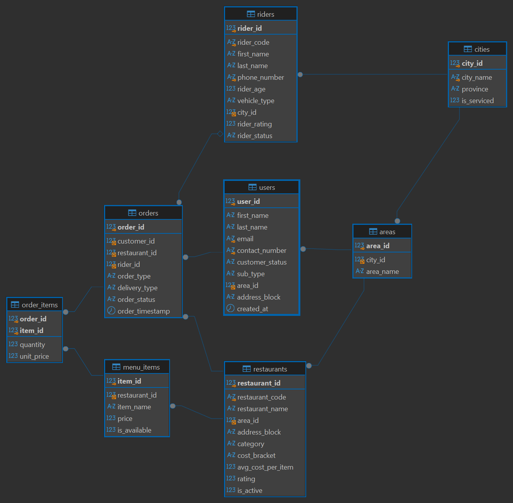
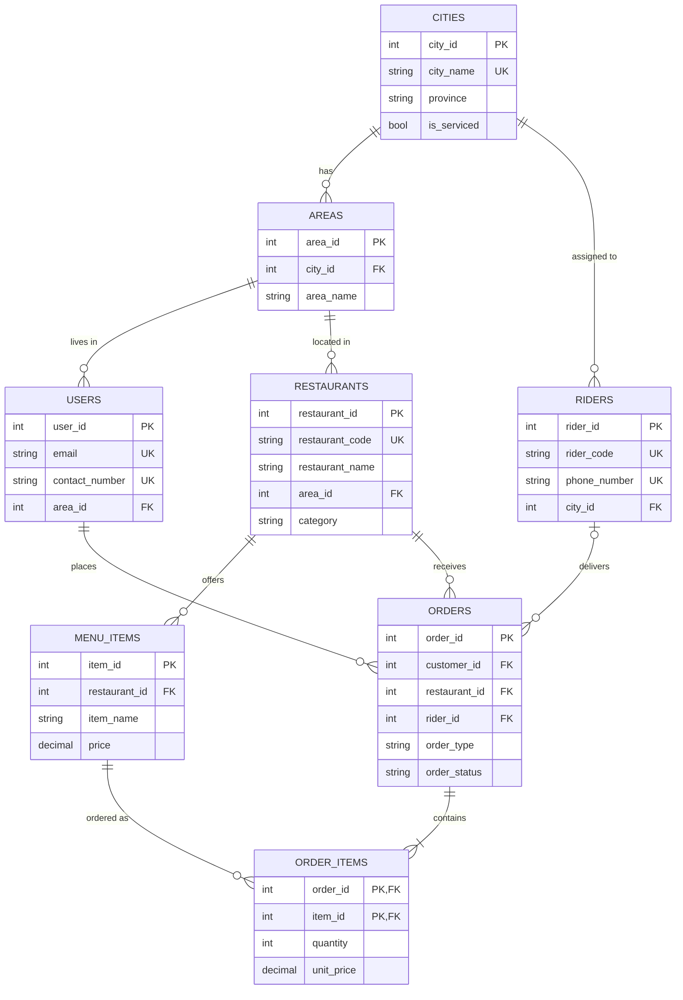
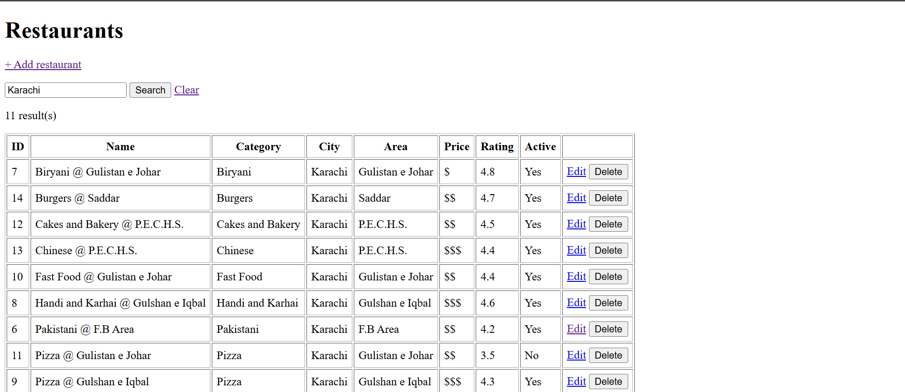

# Swift Eats – Food Delivery Database & Web App

A MySQL database for a food-delivery platform (customers, restaurants, riders, menus, orders) with a Flask web interface for managing restaurants.
Built for the **Database Management** module of the Postgraduate Diploma in Data Science and AI, NED University.

**Author:** Syed Muhammad Umar Tirmizi

This project shows how an **ERD, a SQL database and a web interface** work together in one application:

```
Browser  ──►  Flask (app.py)  ──►  MySQL (swift_eats_web_app)
  forms          routes + SQL          tables, keys, constraints
```

---

## What it does

| Area | Status |
|---|---|
| Normalized 8-table MySQL database with constraints | Done |
| Migration of 1,000 orders from the original v1 database | Done |
| Restaurants page: **view** (3-table join), **search**, **add**, **edit**, **delete** | Done |
| Customers, riders, menu and orders pages | Planned (see Future work) |

## ERD



The same design in text form (renders on GitHub):



**Relationships**

- A city has many areas; users and restaurants each live in one area.
- A restaurant has many menu items.
- A user places many orders; an order belongs to one restaurant and (for deliveries) one rider.
- `order_items` is the **junction table** that resolves the many-to-many relationship between orders and menu items.

## SQL concepts demonstrated

| Concept | Where |
|---|---|
| Tables, primary keys | All 8 tables use auto-increment integer PKs; `order_items` has a composite PK `(order_id, item_id)` |
| Foreign keys | 10 FKs, e.g. `restaurants.area_id → areas.area_id`. `ON DELETE RESTRICT` protects parent rows; `ON DELETE CASCADE` removes an order's lines with the order |
| Constraints | `NOT NULL`, `UNIQUE` (email, phone, restaurant code), `CHECK` (phone format `03XXXXXXXXX`, rider age ≥ 18, rating 1–5, price > 0, quantity > 0, allowed categories and statuses), `DEFAULT` values |
| Business rules | `CHECK` that pick-up orders never have a rider, and deliveries must have one once out for delivery |
| Joins | Restaurants page joins `restaurants → areas → cities`; migration uses `JOIN` and `LEFT JOIN`; verification uses anti-joins (`LEFT JOIN … IS NULL`) |
| CRUD | `INSERT` (add form), `SELECT` (list and search), `UPDATE` (edit form), `DELETE` (delete button) |
| Search | Parameterized `LIKE` across name, category and city |
| Safe queries | Every value reaches MySQL through `%s` placeholders, never string concatenation (prevents SQL injection) |
| Error handling | Duplicate key (1062) and foreign-key (1451) errors are caught and shown as friendly messages |

## Design improvements over v1

This project began as an ERD assignment (`swift_eats`, 4 tables). For the web app it was redesigned and migrated:

| v1 problem | v2 fix |
|---|---|
| `orders.items` stored as comma-separated text (breaks 1NF) | `menu_items` + `order_items` tables |
| City and area text repeated in 3 tables, with hard-coded `CHECK (city IN …)` lists | `cities` and `areas` lookup tables with foreign keys |
| `users.total_orders` stored derived data that goes stale | Removed; to be computed with a query or view |
| `orders.price` stored a total | Totals are now `SUM(quantity * unit_price)` over `order_items`; the migration was verified to reproduce all 1,000 old totals exactly |
| `resturants` spelling | Renamed `restaurants` |

All 1,000 orders were migrated by SQL (`INSERT … SELECT`, `JSON_TABLE` to split the old item text). Verification: row counts match v1, every order has lines, and line totals equal the old `price` column with 0 mismatches.

## Project structure

```
swift-eats-db-app/
├── app.py                 Flask routes
├── db.py                  MySQL connection and query helpers
├── templates/             HTML pages (restaurants list, form, error)
├── SQL/
│   ├── swift_eats_web_app_dump.sql   Full database (structure + data): import this
│   ├── swift_eats_webapp.sql         Schema + migration steps from v1
│   ├── stg_item_prices.sql           Item prices recovered from v1 order totals
│   └── v1/                           Original v1 database scripts
├── docs/                  ERD image and screenshots
├── requirements.txt
└── .env.example           Template for database settings
```

## Setup

**Requirements:** Python 3.10+, MySQL 8.0.16+ (needed for `CHECK` constraints), Git.

1. **Get the code**
   ```
   git clone https://github.com/smus2001/swift-eats-db-app.git
   cd swift-eats-db-app
   ```
2. **Create the database.** In MySQL Workbench or DBeaver, run `SQL/swift_eats_web_app_dump.sql`. It creates and fills `swift_eats_web_app`.
3. **Create a virtual environment and install libraries**
   ```
   python -m venv .venv
   .venv\Scripts\Activate.ps1        # Windows PowerShell
   pip install -r requirements.txt
   ```
4. **Configure the connection.** Copy `.env.example` to `.env` and put in your MySQL password:
   ```
   DB_HOST=localhost
   DB_USER=root
   DB_PASSWORD=your_password
   DB_NAME=swift_eats_web_app
   ```
5. **Run**
   ```
   python app.py
   ```
   Open http://127.0.0.1:5000/restaurants

*(To rebuild from scratch instead of importing the dump: run the v1 scripts in `SQL/v1/`, then `SQL/swift_eats_webapp.sql`, then `SQL/stg_item_prices.sql`.)*

## Screenshots

| Restaurants list and search | Add restaurant |
|---|---|
|  |  |

| Edit restaurant | Delete blocked by foreign key |
|---|---|
|  |  |

## Example queries

Orders per city (joins five tables):

```sql
SELECT c.city_name, COUNT(*) AS orders
FROM orders o
JOIN restaurants r ON r.restaurant_id = o.restaurant_id
JOIN areas a       ON a.area_id = r.area_id
JOIN cities c      ON c.city_id = a.city_id
GROUP BY c.city_name
ORDER BY orders DESC;
```

Order totals rebuilt from line items:

```sql
SELECT order_id, SUM(quantity * unit_price) AS total
FROM order_items
GROUP BY order_id;
```

## Known limitations and future work

- Customers, riders, menu and order pages are not built yet; only the restaurants module has a web interface.
- The v1 data was generated, so some orders pair customers, restaurants and riders from different cities. A same-city rule could be enforced in the order form.
- Restaurant names are placeholders (`Category @ Area`) and can be corrected through the Edit page.
- Planned: place-an-order form (one transaction writing `orders`, `order_items`), reporting views, and a read-only analytics layer.
